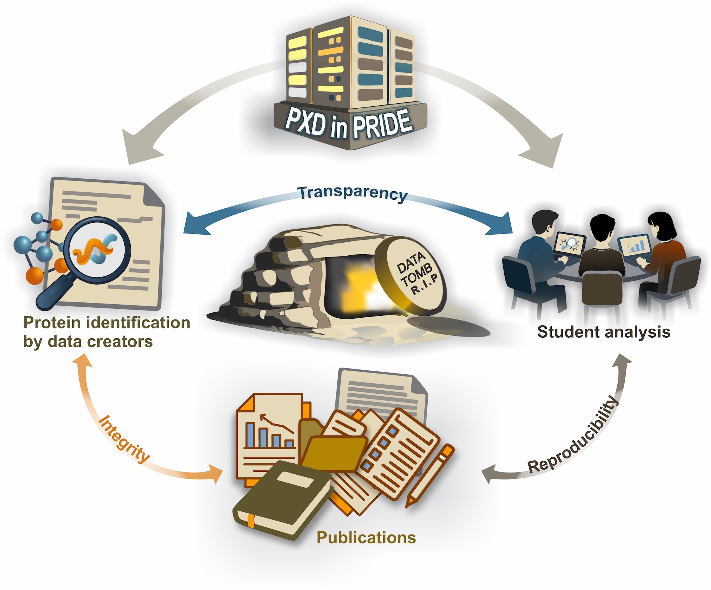

  

<h1 align="center">MS-PROT 2025</h1>

This is the repository for Mass Spectrometry-Based Proteomics: Concepts, Methods, and Data course at the University of Helsinki.

  Spring 2025

---

This repository hosts the R scripts developed by each team, as well as their accompanying reports.

The datasets generated by the teams and the associated input files are archived on Zenodo and can be accessed via the DOI below:

The results of this project have been published in *Scientific Data* (January 2026). The article is available here:
[DOI](https://doi.org/10.1038/s41597-026-06614-8)

**How to cite this work:**
Vadadokhau, U., Soliman, M., Castillon, L., Pastor Muñoz, P., Id, L., Natraj Gayathri, S., Srivastava, A., Runeberg, T., González-Armijos, T., Šapovalovaitė, K., Sakalauskaite, M., Adhikari, S., Abe, O., Tohmola, T., Li, H., Sundaresan, S., Vesikukka, H., Roininen, J., Zangene, E., Soliymani, R., Tuomivaara, S. T., Schwämmle, V., Saei, A. A., Varjosalo, M. & Jafari, M. Preventing Proteomics Data Tombs Through Collective Responsibility and Community Engagement. Sci Data 13, 287 (2026).

  

--- 

# How to execute scripts

Please, clone this repository to your local computer. In RStudio make it as a working directory (with `setwd()`). Place all files from Zenodo repository inside this working directory.

## Team 1
Download EncyclopeDIA `encyclopedia-4.7.11-executable.jar` executable from [repository](https://bitbucket.org/searleb/encyclopedia/downloads/) and Team1_ input files from Zenodo. Place everything in the working directory of this repository on your local computer. Then, run the script.

## Team 2
Download Team2_ input files from Zenodo. Place everything in the working directory of this repository on your local computer. Then, run the script.

If you want to run the MaxQuant in the same manner as the team did, please use `Team2_mqpar.xml` and `Team2_uniprotkb_proteome_UP000006548_AND_revi_2025_05_22.fasta` from Zenodo.

## Team 3
Download Team3_ input files from Zenodo. Place everything in the working directory of this repository on your local computer. Then, run the script.

If you want to run the MaxQuant in the same manner as the team did, please use `Team3_mqpar.xml` and `Team3_uniprotkb_AND_reviewed_true_AND_model_o_2025_05_22.fasta` from Zenodo.

## Team 4
Download Team4_ input files from Zenodo. Place everything in the working directory of this repository on your local computer. Then, run the script.

If you want to run the MaxQuant in the same manner as the team did, please use `Team4_MaxQuant_parameters.txt` from Zenodo.

## Team 5
Download Team5_ input files from Zenodo. Place everything in the working directory of this repository on your local computer. Then, run the script.

Script can be executed only up to step 4. The quantification data was requested from data creators under non-disclosure agreement.

## Team 6
Just open the script and execute it. No input files are needed.
